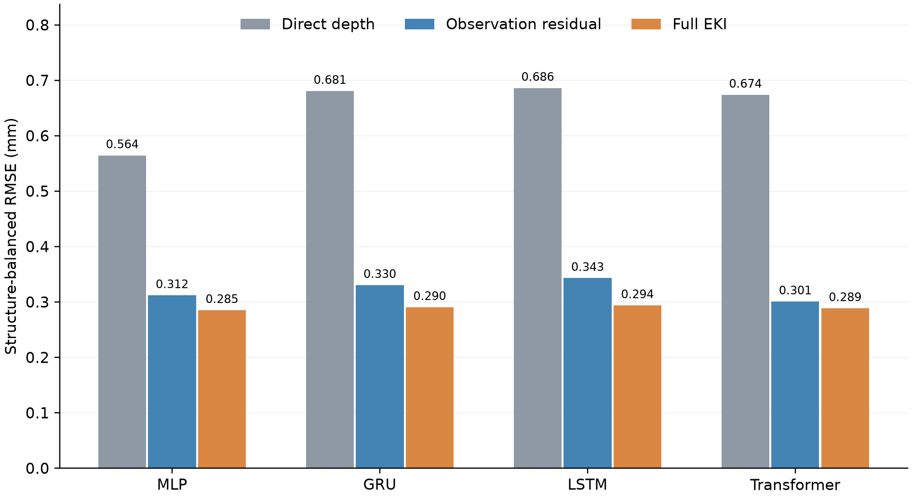

# Turning generic neural learners into pavement experts
### A backbone-agnostic engineering-knowledge interface for rutting prediction

**EKI embeds pavement knowledge into generic neural learners through reusable prediction modules.**
Observation-referenced prediction, layer–material semantics, and constrained load–temperature
responses are integrated with **MLP, GRU, LSTM, and Transformer** backbones. Module definitions
and implementation are reused; each backbone is trained independently.

[Method and evaluation](PROTOCOL.md) · [Results and evidence](RESULTS.md) · [Reproduce](REPRODUCTION.md) · [Download models and data](https://github.com/Zerojy1/Turning-generic-neural-learners-into-pavement-experts/releases)

## Whole-framework comparison

The principal presentation compares a generic direct-depth learner (**A0**) with its
EKI implementation (**A1**). The observation-referenced residual learner (**A2**) is
retained as a bridge to distinguish observation referencing from the additional EKI design.
All three receive historical observation, exposure and structure information.

**Structure-balanced RMSE (mm): 2,089 dated targets, 15 held-out structures, five-seed ensembles.**

| Backbone | Direct depth A0 | Observation residual A2 | Full EKI A1 | Reduction: A0 → A1 |
|---|---:|---:|---:|---:|
| MLP | 0.56436 | 0.31186 | **0.28504** | **49.49%** |
| GRU | 0.68053 | 0.33026 | **0.29049** | **57.31%** |
| LSTM | 0.68601 | 0.34299 | **0.29373** | **57.18%** |
| Transformer | 0.67366 | 0.30066 | **0.28854** | **57.17%** |

EKI reduces RMSE by **49.49%–57.31% relative to direct-depth prediction** in the tested
configurations, and by **4.03%–14.36% relative to observation-residual prediction**.
Each backbone improves on A0 in 14 of 15 held-out structures. Residual XGBoost and
persistence score **0.28947 mm** and **0.41324 mm**, respectively.

## What is embedded

| Module | Engineering role | Implementation |
|---|---|---|
| Observation reference and memory | Condition the next prediction on the measured pavement state | Latest depth, peak–latest discrepancy, and an explicit observation offset |
| Layer–material semantics | Preserve the roles of material, layer position and thickness | Shared slot encoding with thickness-weighted layer aggregation |
| Load–temperature response | Control how current exposure changes the prediction | Daily load accumulation through a nonnegative rate and monotone temperature modulation |

The resulting prediction is

$$\widehat y_t = y_{t-1} + b_\theta(c_t) + \sum_j \Delta N_j\,a_\theta(c_t)\,h_\theta(T_j).$$

Current-interval load and temperature enter through the engineering response pathway.
With context and duration fixed, the output is nondecreasing in these exposures.
**All 125,340 audited EKI perturbations satisfied the specified response constraints.**

## Evidence beyond one-step error

The evaluation includes multi-step prediction, historical-calendar temperature inputs,
missing inspections, late-load subsets, class transfer, component ablations, empirical
prediction intervals, attribution stability and computational cost. The EKI implementations
contain approximately **17k–72k parameters**; measured cost is reported rather than inferred
from parameter count alone.

- [Three-level comparison and all supplementary tables](supplements/direct-depth/results/tables/)
- [Components, response audits, transfer, explanations and cost](results/tables/)
- [All evaluation arms and scenarios](all_arms_and_scenarios.csv)
- [Figures](figures/) and [three-level comparison figures](supplements/direct-depth/figures/)

## Scope of the evidence

This is a single-site exploratory evaluation; external validation remains open. Direct
baselines are weaker than persistence under the fixed budget, so percentage improvements
describe these matched configurations. Benefits vary by scenario: EKI is weaker than A2
for one missing inspection, and noninferiority to unconstrained counterparts was not
established across all four backbones. See [Results](RESULTS.md) for all comparisons and
[Protocol](PROTOCOL.md#study-status-and-inferential-scope) for the study's inferential scope.

## Models, data and verification

| Distribution | Contents | Download |
|---|---|---|
| EKI evaluation | 605 fitted model configurations, inputs, all scenarios, components and attribution artifacts | [v1.0.0](https://github.com/Zerojy1/Turning-generic-neural-learners-into-pavement-experts/releases/tag/v1.0.0) |
| Matched direct-depth evaluation | 100 additional direct-depth models, three-level comparisons, scenarios and intervals | [v1.1.0](https://github.com/Zerojy1/Turning-generic-neural-learners-into-pavement-experts/releases/tag/v1.1.0) |

The releases retain their verified snapshots, SHA-256 manifests and independent replay
records. Run reproduction from the release extraction; this branch provides the current
reader-facing documentation and a browsable source/results mirror.
