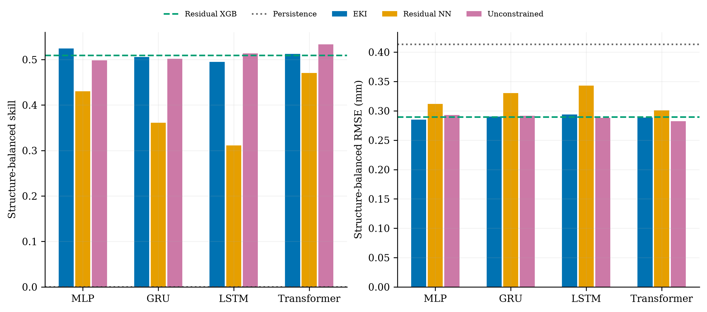

# Turning generic neural learners into pavement experts: A backbone-agnostic engineering-knowledge interface for rutting prediction

**EKI** embeds observation referencing, layer–material semantics, and constrained
load–temperature responses into MLP, GRU, LSTM, and Transformer learners. The same
module implementation is reused across backbones; each model learns its own weights.

## Matched direct-depth supplement (v1.1.0)

The new supplement adds 100 direct-depth models (A0), matched to the ordinary residual
models (A2) in architecture, available inputs, initialization rules and training budget.
Each version is fitted independently. Existing A1/A2 and tree predictions are reused
unchanged. RMSE below is in millimetres, with structure-balanced aggregation.

| Backbone | Direct depth A0 | Ordinary residual A2 | Full EKI A1 | A1 vs A0 reduction | A1 vs A2 reduction |
|---|---:|---:|---:|---:|---:|
| MLP | 0.56436 | 0.31186 | 0.28504 | 49.49% | 8.60% |
| GRU | 0.68053 | 0.33026 | 0.29049 | 57.31% | 12.04% |
| LSTM | 0.68601 | 0.34299 | 0.29373 | 57.18% | 14.36% |
| Transformer | 0.67366 | 0.30066 | 0.28854 | 57.17% | 4.03% |

The four new A1-versus-A0 comparisons meet the frozen Holm-adjusted criterion
(adjusted p=0.03720–0.03960), with lower errors on 14/15 test structures for each backbone.
These comparisons are exploratory additions on previously examined data. Direct-depth
baselines are weaker than persistence under this budget; the percentage reductions are
not a claim about the best possible direct predictors. A1-versus-A0 measures the whole
formulation, not the separate benefit of every engineering component. The original
4.03%–14.36% improvements remain A1-versus-A2 comparisons.

All 100 fitted models were independently replayed, primary statistics and 360 calibration
groups recomputed, and reused scores checked unchanged. The complete ZIP also passed
Windows CRC and SHA-256 checks for all 2,648 manifest members.

Limitations remain visible: EKI is less accurate than ordinary residual networks for
one missing inspection; XGBoost is more accurate in four-step historical-calendar
prediction; worst-structure interval coverage can be low. Original P1 passed and P2
did not establish noninferiority. No independent external validation has been added.

- [Supplement guide](supplements/direct-depth/README.md), [three-level main table](supplements/direct-depth/results/tables/three_level_main_table.csv), and [Chinese scientific report](supplements/direct-depth/REPORT_ZH.md).
- [Complete supplement release](https://github.com/Zerojy1/Turning-generic-neural-learners-into-pavement-experts/releases/tag/v1.1.0): all new weights, data, predictions, learning curves, source and reproduction manifest.
- [Original EKI release v1.0.0](https://github.com/Zerojy1/Turning-generic-neural-learners-into-pavement-experts/releases/tag/v1.0.0) is retained unchanged and supplies the original EKI weights.

## Original EKI versus ordinary residual results

| Backbone | Ordinary residual RMSE (mm) | EKI RMSE (mm) | RMSE reduction |
|---|---:|---:|---:|
| MLP | 0.31186 | 0.28504 | 8.60% |
| GRU | 0.33026 | 0.29049 | 12.04% |
| LSTM | 0.34299 | 0.29373 | 14.36% |
| Transformer | 0.30066 | 0.28854 | 4.03% |

These are structure-balanced results on 2,089 dated targets from 15 held-out structures.
Five seeds are averaged in millimetres before evaluation. The residual XGBoost reference
has RMSE 0.28947 mm and persistence 0.41324 mm on the same targets.

- Cross-backbone superiority over ordinary residual networks met P1 (Holm p=0.0339966).
- All 125,340 fixed-context EKI response checks satisfied the specified monotonicity.
- Semantic structure ablations support useful representation on the two tested backbones.
- Historical calendar temperatures improve multi-step prediction relative to recent-temperature continuation.

The complete evaluation also measures trade-offs: P2 did not establish noninferiority
to unconstrained counterparts on all four backbones (Holm p=0.273873); the independent
benefit of current temperature modulation is uncertain; missing-inspection performance
decreases; class-transfer and explanation-background results vary. See [Results](RESULTS.md).
The title expresses domain specialization; it does not claim performance equal to human experts.

## Files and downloads

- [All experiment arms and scenarios](all_arms_and_scenarios.csv): 2,387 summary records.
- [31 result tables](results/tables/) and [11 figures in PNG/PDF](figures/).
- [Frozen numerical inputs](data/), [target manifest](target_manifest.csv),
  [run matrix](run_matrix.csv), [protocol](protocol.json), and model source in this repository.
- [Complete current-study package](https://github.com/Zerojy1/Turning-generic-neural-learners-into-pavement-experts/releases/download/v1.0.0/eki-latest-experiment.zip):
  all 605 fitted models, inner candidates, learning curves, seed predictions, scenario
  outputs, calibration data, attribution coalitions, and temperature source records.
- [SHA-256 checksums](https://github.com/Zerojy1/Turning-generic-neural-learners-into-pavement-experts/releases/download/v1.0.0/SHA256SUMS.txt).

The large files are release assets rather than Git blobs. The original v1.0.0 `FILE_MANIFEST.json` identifies
every distribution file, its checksum, and whether it is stored in Git or the complete asset.
All current arms, seeds and evaluation subsets are included.

## Reproduction

See [REPRODUCTION.md](REPRODUCTION.md). The package includes byte-identical numerical
artifacts and a documented packaging-only source adaptation ledger. No model was
retrained and no result was selected or changed during publication packaging.

## Evaluation scope

This is a single-site exploratory evaluation under structure-grouped validation.
External independent validation is not available. Temperature/load monotonicity is
conditional on fixed history and context; it is not causal identification or guaranteed
trajectory monotonicity. Prediction intervals use empirical inner-data calibration.
See [PROTOCOL.md](PROTOCOL.md) for assumptions, comparisons and validity boundaries.

