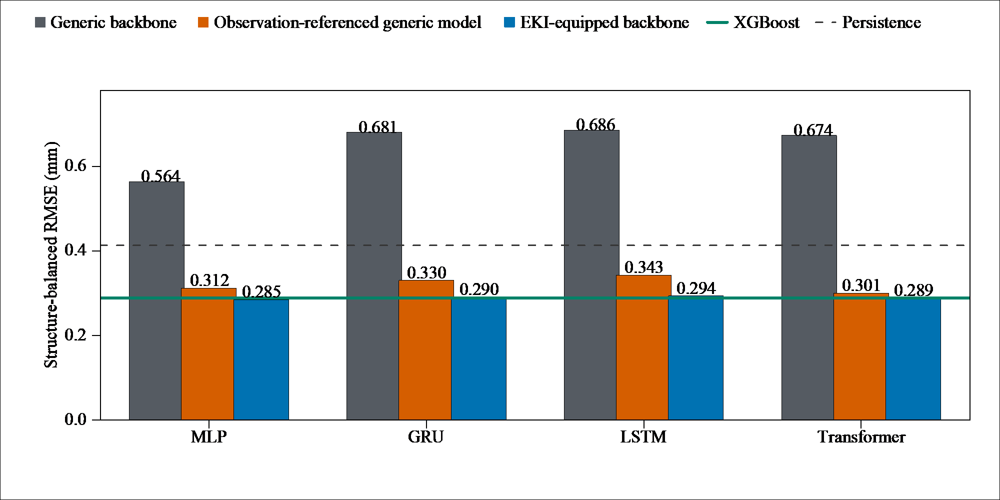
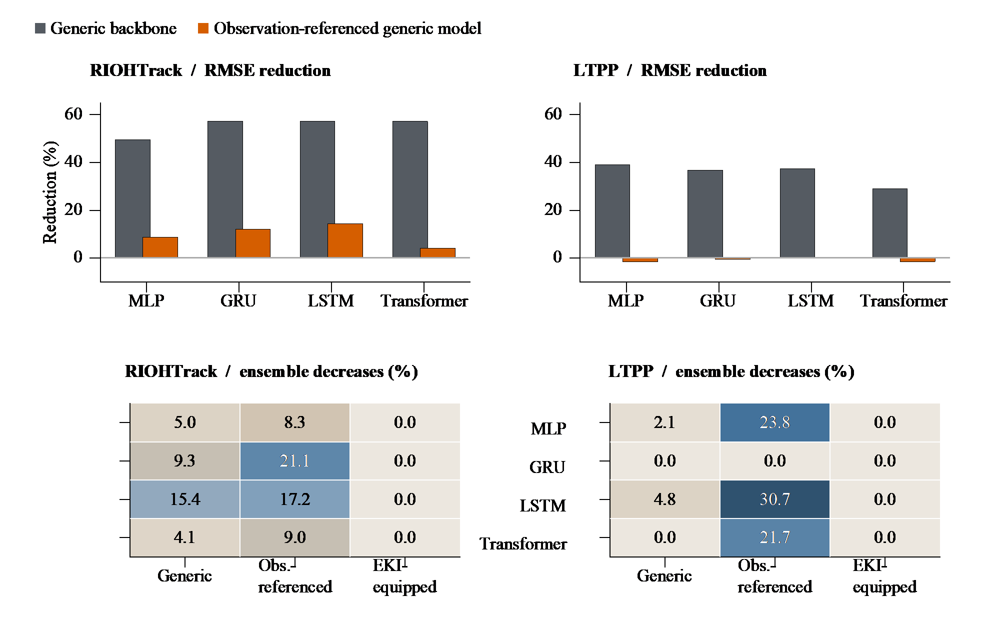

# Reusable engineering-knowledge modules for reliable neural rutting forecasting

**Better rutting forecasts across four neural backbones, with engineering-consistent exposure responses.**

EKI integrates observation anchoring, layer–material encoding and a monotonic load–temperature pathway with **MLP, GRU, LSTM and Transformer**. The same engineering design is fitted independently with each backbone.

## Main results

| Accuracy on RIOHTrack | Accuracy on LTPP | Engineering consistency |
|:---:|:---:|:---:|
| **49.5–57.3% lower RMSE** | **29.0–39.1% lower RMSE** | **Zero decreasing responses** |
| Across all four backbones | Across all four locally fitted backbones | In the specified load and temperature checks |

RMSE reductions are relative to matched direct-depth neural models. RIOHTrack evaluates **2,089 targets from 15 held-out structures**; LTPP evaluates **63 targets from 26 sections in seven held-out states** after local retraining. All four EKI backbones outperform persistence on both evaluations.

## Accuracy across four neural backbones

**EKI reaches 0.2850–0.2937 mm RMSE on RIOHTrack.** Beyond observation anchoring alone, the complete interface reduces RMSE by a further **4.0–14.4%**. The chart shows structure-balanced errors from five-seed ensembles. [Numerical results](RESULTS.md#forecast-accuracy-across-neural-backbones)

## Accuracy and response consistency across datasets

**The monotonic pathway guarantees nondecreasing exposure responses at a fixed prediction origin.** Audits confirm zero EKI violations in **125,340 individual-fit checks** on RIOHTrack and **756 ensemble checks** on locally fitted LTPP models. The heatmaps above use ensemble rates for both datasets. RIOHTrack one-step prediction intervals also attain **95.0–95.3% mean coverage** at the nominal 95% level. [Full accuracy and reliability comparisons](RESULTS.md)

## Reusable engineering modules

**OA — Observation anchoring** carries the latest measured depth into the forecast. **LME — Layer–material encoding** represents pavement composition through shared encoding and thickness-weighted pooling. **MLT — Monotonic load–temperature pathway** controls how current exposure affects the output.

[Method and validation](PROTOCOL.md) · [Module ablations](supplements/modules/README.md) · [LTPP evaluation](supplements/ltpp/README.md) · [Paper-to-code guide](MANUSCRIPT_GUIDE.md) · [Data, models and reproduction](REPRODUCTION.md)

Complete comparator results and conditions of use are provided in [Results](RESULTS.md), including comparisons with anchoring alone, missed inspections and frozen-weight transfer.
